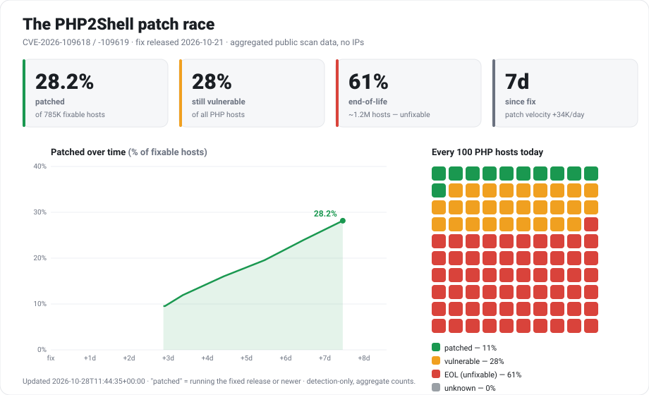
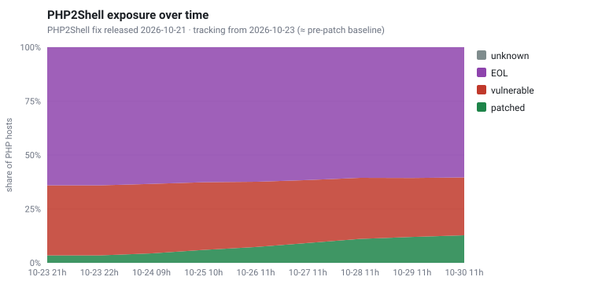
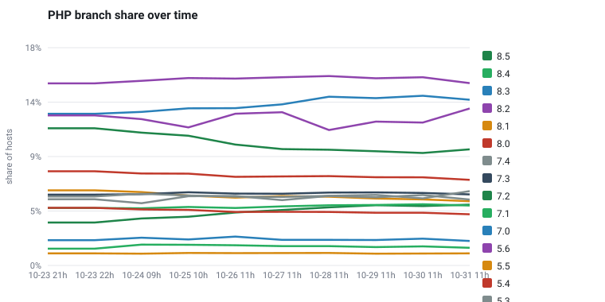

# php2shell-trends

**How fast is the internet patching PHP against PHP2Shell?** A live, community-visible tracker
of PHP version exposure over time — the share of internet-facing PHP hosts that are
**patched**, still **vulnerable** (CVE-2026-109618 / CVE-2026-109619, fixed 2026-10-21 in
8.2.35 / 8.3.36 / 8.4.27 / 8.5.12), or **end-of-life** — plus how PHP branch usage shifts.

### ▶ [Live interactive dashboard](https://pagvac.github.io/php2shell-trends/)



<details>
<summary>More charts (fill in as data accumulates)</summary>

### PHP2Shell exposure over time


### PHP branch share over time


</details>

## About the data

- **No scanning.** This project never probes any host. It publishes **anonymized aggregate
  counts** derived from public internet-measurement data — no IP addresses, no per-host records.
- **The honest framing:** ~2/3 of internet-facing PHP hosts run **end-of-life** versions that
  will *never* get a fix, so the "fixable" universe is only the supported-branch minority. The
  dashboard shows **% patched of the *fixable* population** next to the raw numbers, because
  that is the number that reflects whether the patch race is being won.
- **Updated daily.** `data/timeseries.json` holds the full series (counts by status and by PHP
  branch); the dashboard and charts are regenerated from it.
- **Measurement lag.** Counts come from a rolling **~30-day** measurement window, so each point is
  a trailing-30-day aggregate — trend changes lag real-world patching by up to ~30 days, and the
  curve is smoothed rather than same-day. The underlying data refreshes on a day-to-week scale, so
  daily is the finest cadence that carries real signal.
- **Thresholds:** safe minimums 8.2.35 / 8.3.36 / 8.4.27 / 8.5.12; branches below 8.2 are EOL.

## Layout

```
index.html · dashboard.js    the interactive dashboard (ECharts, served via GitHub Pages)
data/timeseries.json         daily anonymized aggregate series
charts/*.svg                  static chart images embedded above
```

## License

[MIT](LICENSE).
